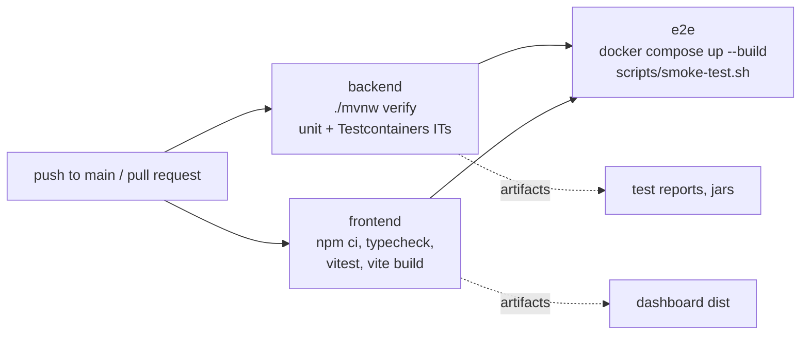

# Continuous integration

The pipeline is GitHub Actions ([`.github/workflows/ci.yml`](.github/workflows/ci.yml)). This page
explains what it does and maps every part to its TeamCity equivalent, because the concepts are the
same and only the names differ.

## The pipeline



| Job | Steps | Fails when |
|---|---|---|
| `backend` | checkout, JDK 21 with Maven cache, `./mvnw -B -ntp verify` | any unit or integration test fails (Testcontainers starts real Kafka and PostgreSQL on the runner's Docker) |
| `frontend` | checkout, Node 22 with npm cache, `npm ci`, `npm run typecheck`, `npm test`, `npm run build` | a type error, a failing Vitest test, or a broken production build |
| `e2e` | builds all images, starts the Compose stack, runs `scripts/smoke-test.sh`, prints logs on failure, tears down | the stack does not become ready, events do not flow, an injected fault is not handled as expected, or Prometheus/Grafana/nginx are broken |

A second workflow, [`loadtest.yml`](.github/workflows/loadtest.yml), is started by hand. It runs the
load test on a GitHub-hosted runner and attaches the report.

`concurrency` cancels an older run of the same branch when a newer commit arrives, so the queue
never fills with stale builds.

## Mapping to TeamCity

| TeamCity concept | What it is | In this project |
|---|---|---|
| **Project** | Container for build configurations, VCS roots and settings | The repository and its `.github/workflows` folder |
| **Build configuration** | One kind of build: its steps, triggers, requirements, artifacts | Each job: `backend`, `frontend`, `e2e`; and the separate `Load test` workflow |
| **VCS root** | Where the source comes from and which branches to watch | The `actions/checkout` step plus the `on.push.branches` / `pull_request` filters |
| **Trigger** (VCS trigger, schedule, finish-build) | What starts a build | `on: push` (VCS trigger on main), `on: pull_request` (per-branch/PR builds), `workflow_dispatch` (manual "Run" button). A nightly schedule would be `on: schedule` |
| **Build step** (Maven runner, command line, Docker) | One command in a build | Each `run:` line: the Maven runner is `./mvnw -B verify`; command-line steps run `npm` and the smoke script; the Docker step is `docker compose up --build` |
| **Build agent** | The machine that executes the build | The `runs-on: ubuntu-latest` runner. A self-hosted runner is the equivalent of a self-hosted agent |
| **Agent requirements** | Conditions an agent must meet (JDK version, Docker present) | `actions/setup-java` (JDK 21) and `actions/setup-node` (Node 22) install the tools; Docker is part of the runner image |
| **Artifact paths** | Files published from a build | `actions/upload-artifact`: test reports, the three jars, the dashboard `dist` folder, load test results |
| **Artifact dependency** | One build consuming another's artifacts | Not needed here because `e2e` builds images from source; in TeamCity, e2e could take the jars from `backend` instead of rebuilding |
| **Snapshot dependency / build chain** | Builds that must succeed first, all on the same source revision | `needs: [backend, frontend]` on `e2e`: e2e only runs when both pass, on the same commit. That is a build chain |
| **Build failure conditions** | Rules that fail a build beyond exit code | A non-zero exit code from any step; tests report through Surefire/Failsafe exit codes. TeamCity could additionally fail on, for example, a drop in test count |
| **Test reporting** | TeamCity parses JUnit XML and shows test history | Surefire/Failsafe reports are uploaded as artifacts; TeamCity's Maven runner would pick them up automatically |
| **Parameters** | Values injected into builds (`%env.X%`) | `env:` / workflow inputs (the load test's `events` input) |
| **Caching / build cache** | Reusing dependencies between builds | `cache: maven` and `cache: npm` on the setup actions |
| **Kotlin DSL (`.teamcity/settings.kts`)** | Versioned build configuration | The workflow YAML files, versioned with the code |

## Reproducing CI locally

```bash
./mvnw -B verify                       # backend job
cd frontend && npm ci && npm run typecheck && npm test && npm run build   # frontend job
scripts/smoke-test.sh && docker compose down -v                           # e2e job (Linux/macOS/WSL)
```
