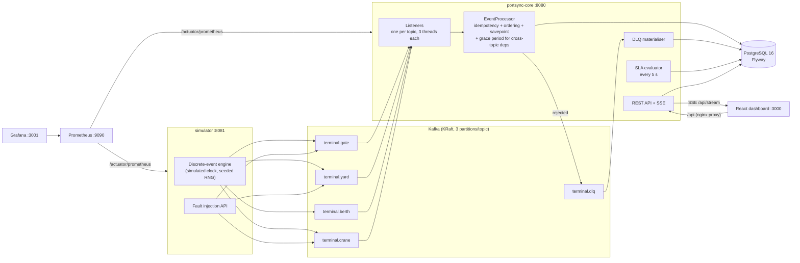
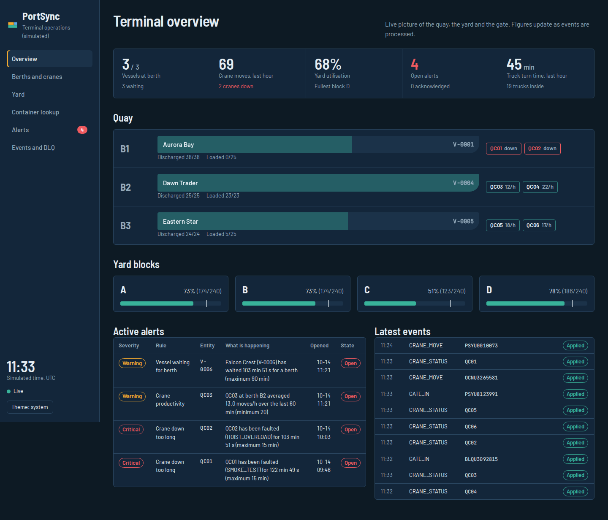
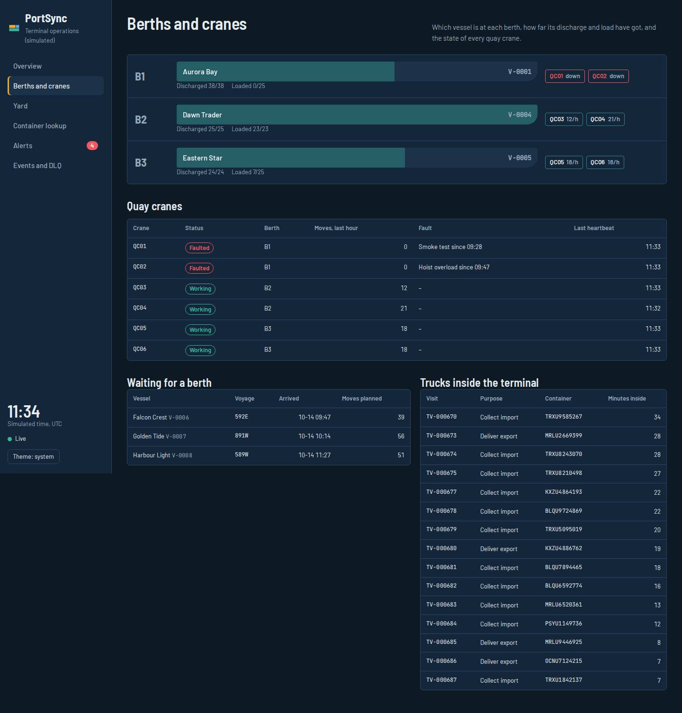
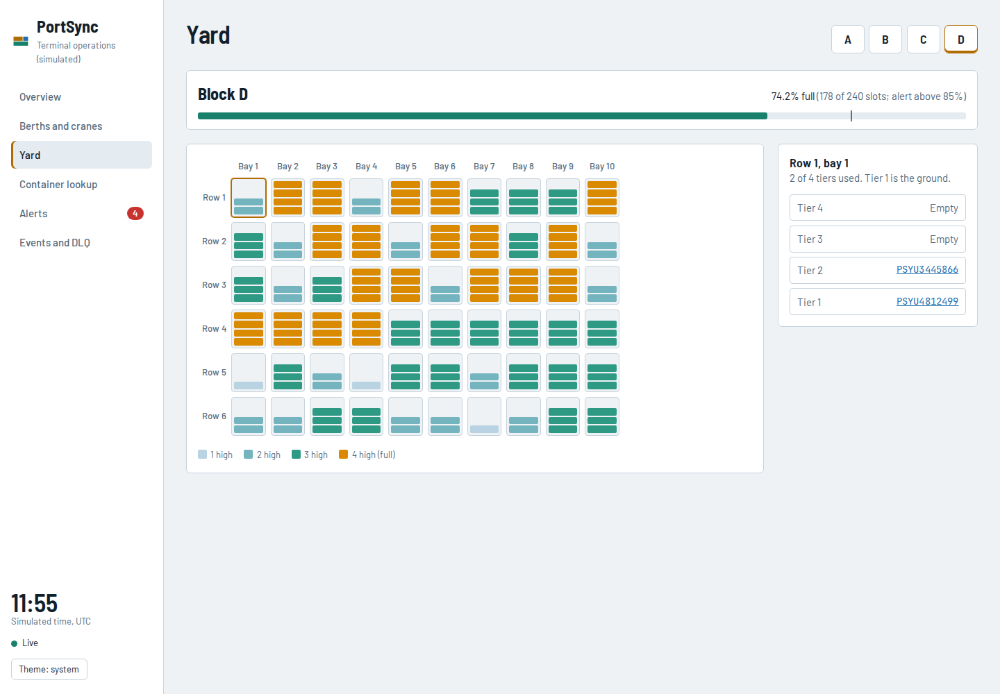
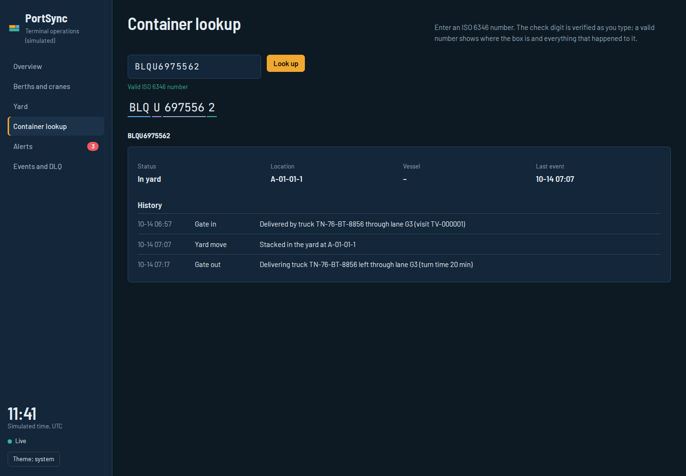
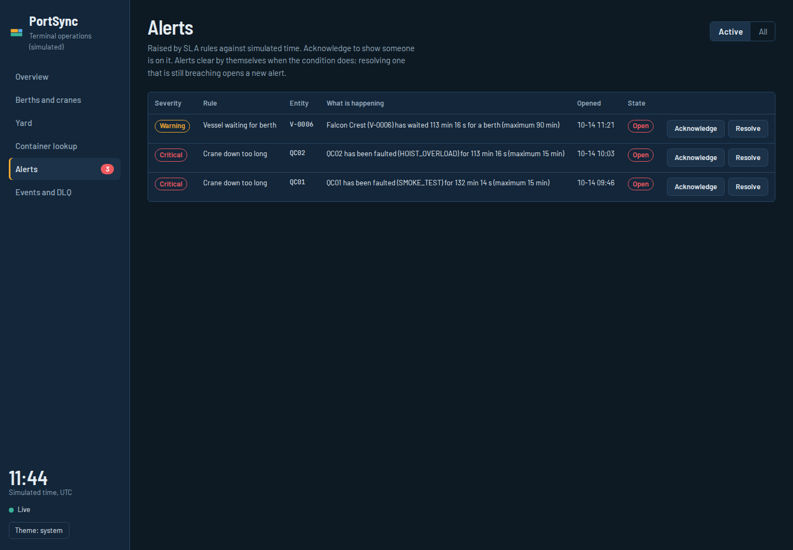
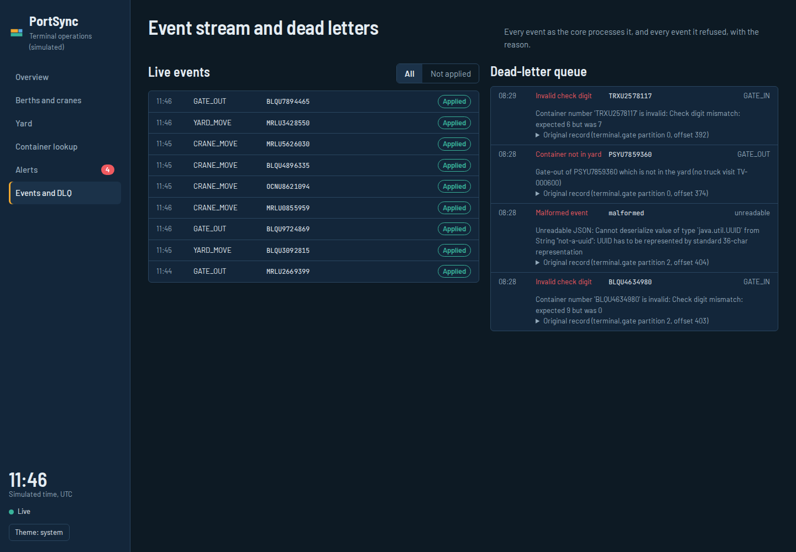

# PortSync

[](https://github.com/RaktimChandra/PortSync/actions/workflows/ci.yml)

PortSync is a terminal-operations monitoring system for a simulated container port. Crane, berth,
gate and yard events stream through Apache Kafka into a Spring Boot service that keeps yard
inventory and berth/crane state in PostgreSQL, evaluates service-level rules, raises alerts and
pushes live updates to a React dashboard.

It is a learning simulation of the container-terminal domain, built to practise the things that
matter in operations software: exactly-once effects on top of at-least-once delivery, ordering,
invariants that never break, dead-lettering instead of crashing, and observability you can operate.

> Not affiliated with any terminal operating system vendor. All names, vessels and container owner
> codes are invented.

## What it does

- **Simulator** runs a terminal on a fast clock (60x by default: one simulated minute per second):
  vessels arrive and berth, six quay cranes discharge and load, trucks deliver exports and collect
  imports, cranes break down and get repaired. Every step is published to Kafka.
- **portsync-core** consumes those events and applies them to PostgreSQL **exactly once**, rejects
  impossible ones to a dead-letter topic with a reason, ignores out-of-order ones by a documented rule,
  evaluates five SLA rules against simulated time and manages alerts through
  `OPEN → ACKNOWLEDGED → RESOLVED`.
- **Dashboard** shows the quay, the yard stack by stack, container histories, alerts and the live
  event stream, updated over Server-Sent Events.
- **Fault injection** endpoints break things on purpose (crane faults, gate surges, duplicates,
  out-of-order and invalid events) so every rule can be demonstrated live.

## Architecture



| Module | What it is |
|---|---|
| `portsync-events` | Shared, framework-free contract: event envelope, payloads, topics, terminal layout, ISO 6346 numbers, yard stacking rules. JSON Schema in `src/main/resources/schema`. |
| `simulator` | Spring Boot app generating the terminal and exposing fault injection. |
| `portsync-core` | Spring Boot app: Kafka consumer, PostgreSQL state, SLA rules, alerts, REST, SSE, metrics. |
| `loadtest` | Command-line load generator that reports measured throughput and latency. |
| `frontend` | React 18 + Vite + TypeScript dashboard. |
| `infra` | Prometheus scrape config and the provisioned Grafana dashboard. |

Tech: Java 21, Spring Boot 3.5, Apache Kafka 3.9 (KRaft), PostgreSQL 16 + Flyway, React 18, Vite 6,
TypeScript, Docker Compose, JUnit 5, Mockito, Testcontainers, REST Assured, Vitest, GitHub Actions.

## Run it

You need Docker Desktop (with WSL 2 on Windows). Nothing else is required for the full stack.

```bash
git clone https://github.com/RaktimChandra/PortSync.git
cd PortSync
docker compose up -d --build
```

The first build downloads dependencies and takes a few minutes. Then open:

| What | Where |
|---|---|
| Dashboard | http://localhost:3000 |
| Core API docs (Swagger UI) | http://localhost:8080/swagger-ui.html |
| Simulator and fault injection (Swagger UI) | http://localhost:8081/swagger-ui.html |
| Grafana (admin / admin) | http://localhost:3001 |
| Prometheus | http://localhost:9090 |
| Health / readiness | http://localhost:8080/actuator/health |

Stop with `docker compose down` (add `-v` to also delete the database and Kafka data).

Step-by-step Windows instructions, including running the apps from VS Code against Dockerised
Kafka and PostgreSQL, are in [docs/WINDOWS.md](docs/WINDOWS.md).

### Five-minute demo

With the stack running, use the simulator's Swagger UI or these commands:

```bash
curl -X POST "localhost:8081/api/faults/cranes/QC01/fault?code=SPREADER_JAM"   # crane down; alert after 15 sim-min (~15 s)
curl -X POST "localhost:8081/api/faults/gate-surge"                            # trucks flood the fullest block past 85%
curl -X POST "localhost:8081/api/faults/vessel-surge?vessels=4"                # vessels queue for a berth
curl -X POST "localhost:8081/api/faults/cranes/QC03/slow?factor=0.4"           # productivity alert after a full window
curl -X POST "localhost:8081/api/faults/duplicates?count=10"                   # all ignored: nothing changes
curl -X POST "localhost:8081/api/faults/out-of-order"                          # back-dated event: ignored as stale
curl -X POST "localhost:8081/api/faults/invalid-container"                     # bad check digit: DLQ
curl -X POST "localhost:8081/api/faults/impossible?kind=MOVE_ON_FAULTED_CRANE" # DLQ: CRANE_FAULTED
curl -X POST "localhost:8081/api/faults/cranes/QC01/recover"                   # alert clears by itself
```

Each call returns the events it published and the outcome the core should produce, so you can
check it on the **Events and DLQ** and **Alerts** pages.

## Screenshots

Captured from the running Compose stack (60x simulated time, faults injected so alerts show) by
`scripts/screenshots.mjs` on 14 October 2026. Every page also has a light theme
(`docs/screenshots/*-light.png`); the dashboard follows the system setting or the toggle.

**Overview**: KPIs, the quay with vessels and crane rates, yard blocks, active alerts, latest events



**Berths and cranes**



**Yard**: block D stack by stack, with the selected stack's tiers (light theme)



**Container lookup**: ISO 6346 validation, location and full event history



**Alerts**



**Events and DLQ**: live stream and rejected events with reasons



The provisioned Grafana dashboard is at http://localhost:3001 once the stack is running.

## Tests

```bash
./mvnw verify            # all Java tests; integration tests need Docker running
cd frontend && npm test  # Vitest
```

What each suite proves, and how to run one at a time: [TESTING.md](TESTING.md).
CI runs the backend suite, the frontend suite and an end-to-end smoke test of the whole Compose
stack on every push: [CI.md](CI.md).

## Performance

Throughput and latency figures live in [RESULTS.md](RESULTS.md), each with the date, the machine and
the exact command, because a number without its conditions means nothing. Reproduce them with
`scripts/run-loadtest.sh` or `docker compose --profile loadtest run --rm loadtest`.

## Documentation

- [DESIGN.md](DESIGN.md): every key decision and its trade-off
- [docs/EVENTS.md](docs/EVENTS.md): event catalogue, keys, topics and the JSON Schema
- [TESTING.md](TESTING.md): test strategy
- [CI.md](CI.md): the pipeline, mapped to TeamCity concepts
- [INTERVIEW.md](INTERVIEW.md): a two-minute walkthrough and likely questions
- [RESULTS.md](RESULTS.md): measured numbers

## Licence

MIT
