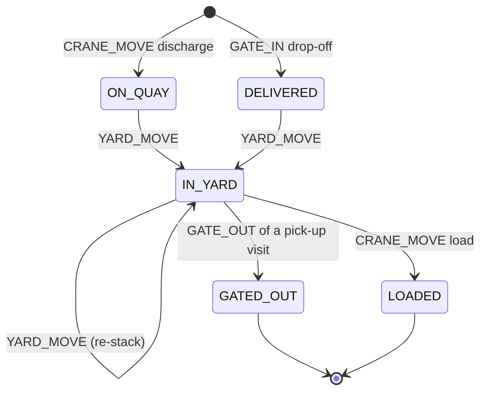

# Event catalogue

Every event travels in the same envelope. The formal contract is the JSON Schema
[`terminal-event.schema.json`](../portsync-events/src/main/resources/schema/terminal-event.schema.json)
(draft 2020-12); `TerminalEventContractTest` checks that one event of every type validates against it.

```json
{
  "schemaVersion": 1,
  "eventId": "6f1c2a3b-8d0e-4f4a-9a43-0d6c1e2f7b55",
  "type": "CRANE_MOVE",
  "occurredAt": "2026-10-14T08:15:00Z",
  "entityId": "CSQU3054383",
  "source": "simulator",
  "payload": { "craneId": "QC01", "vesselId": "V-0007", "kind": "DISCHARGE" }
}
```

| Field | Meaning |
|---|---|
| `schemaVersion` | Envelope version, currently 1 |
| `eventId` | UUID, unique per event. The idempotency key: a redelivered or duplicated event has the same id |
| `type` | One of the types below |
| `occurredAt` | When it happened, in **simulated** time, ISO-8601 UTC |
| `entityId` | The vessel visit, crane or container the event is about. Also the Kafka record key |
| `source` | Producer name (`simulator`, `loadtest`, ...) |
| `payload` | Type-specific object |

Unknown fields are ignored by the consumer, so producers can add optional fields without breaking it.

## Types

| Type | Topic | entityId | Payload | Effect in portsync-core |
|---|---|---|---|---|
| `VESSEL_ARRIVED` | terminal.berth | vessel visit `V-0001` | `vesselName`, `voyage`, `dischargeCount`, `loadCount` | Vessel created as WAITING |
| `BERTH_ASSIGNED` | terminal.berth | vessel visit | `berthId` (B1-B3), `craneIds` | Vessel AT_BERTH, berth occupied, cranes assigned |
| `VESSEL_DEPARTED` | terminal.berth | vessel visit | `berthId` | Vessel DEPARTED, berth and cranes freed |
| `CRANE_STATUS` | terminal.crane | crane `QC01`-`QC06` | `signal` HEARTBEAT / FAULT / RECOVERED, `faultCode` | Heartbeat time, fault start, recovery |
| `CRANE_MOVE` | terminal.crane | container | `craneId`, `vesselId`, `kind` DISCHARGE / LOAD | DISCHARGE: container ON_QUAY. LOAD: removed from the yard, LOADED |
| `GATE_IN` | terminal.gate | container | `truckVisitId`, `lane` (G1-G4), `direction` DROP_OFF / PICK_UP, `truckPlate` | Truck visit opened; DROP_OFF creates the container as DELIVERED |
| `GATE_OUT` | terminal.gate | container | `truckVisitId`, `lane` | Visit closed; PICK_UP removes the container from the yard (GATED_OUT) |
| `YARD_MOVE` | terminal.yard | container | `block` (A-D), `row` (1-6), `bay` (1-10), `tier` (1-4, as reported) | Container set down on top of that stack (the reported tier is recorded if it differs); IN_YARD |

## Container lifecycle



A container that has left (GATED_OUT or LOADED) can come back later; a new lifecycle starts.

## Rejection reasons (terminal.dlq)

| Reason | Example |
|---|---|
| `MALFORMED_EVENT` | Not JSON, missing envelope field, unknown type, payload of the wrong shape |
| `INVALID_CHECK_DIGIT` | Container number fails ISO 6346 |
| `UNKNOWN_EQUIPMENT` | Crane QC09, berth B7, lane G9 |
| `UNKNOWN_VESSEL` | BERTH_ASSIGNED for a vessel that never arrived |
| `VESSEL_STATE_CONFLICT` | Berthing a vessel that is already berthed |
| `BERTH_OCCUPIED` | Berth already has a vessel |
| `CRANE_FAULTED` | CRANE_MOVE by a faulted crane |
| `CRANE_NOT_ASSIGNED` | Crane is not at the vessel's berth |
| `CRANE_UNAVAILABLE` | Assigning a crane that works another berth |
| `CONTAINER_STATE_CONFLICT` | Discharging a container that is already on the terminal |
| `CONTAINER_NOT_IN_YARD` | GATE_OUT or LOAD of a container not in the yard |
| `SLOT_INVALID` | Slot outside the layout |
| `STACK_FULL` | The stack already holds four containers |
| `UNKNOWN_TRUCK_VISIT` | GATE_OUT for a visit that never gated in |
| `TRUCK_VISIT_CONFLICT` | Visit id reused, or two trucks for one container |
| `PROCESSING_FAILED` | Unexpected error that persisted through all retries |

Dead-lettered records keep the original value byte for byte. Headers: `portsync-dlq-reason`,
`portsync-dlq-detail`, `portsync-source-topic`, `portsync-source-partition`, `portsync-source-offset`.
